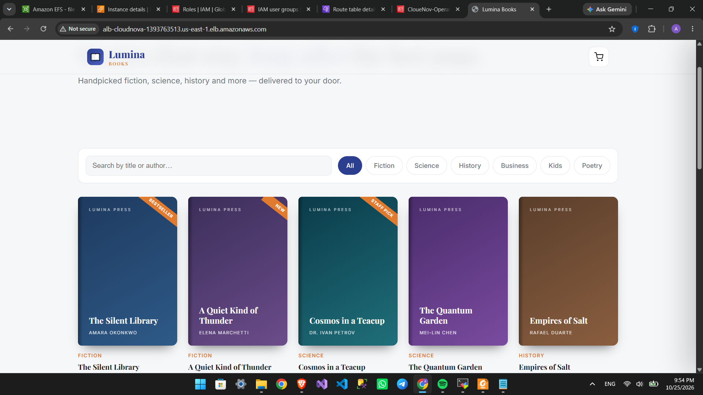
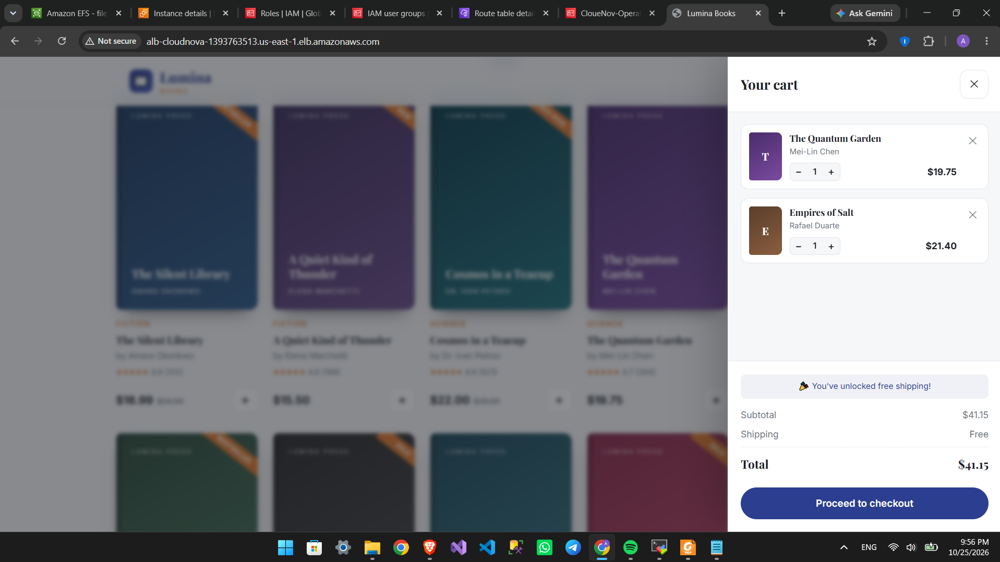
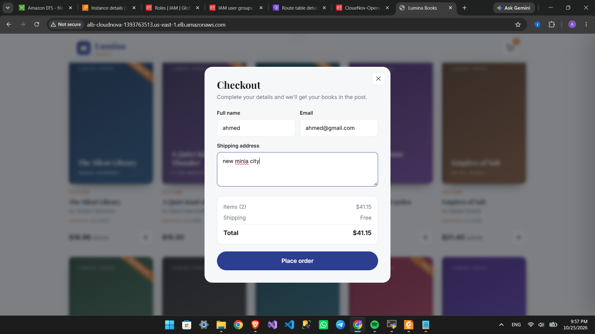
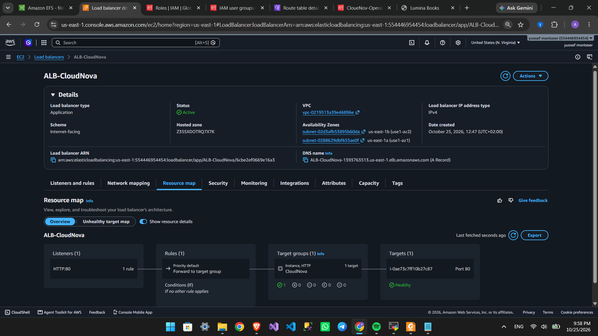
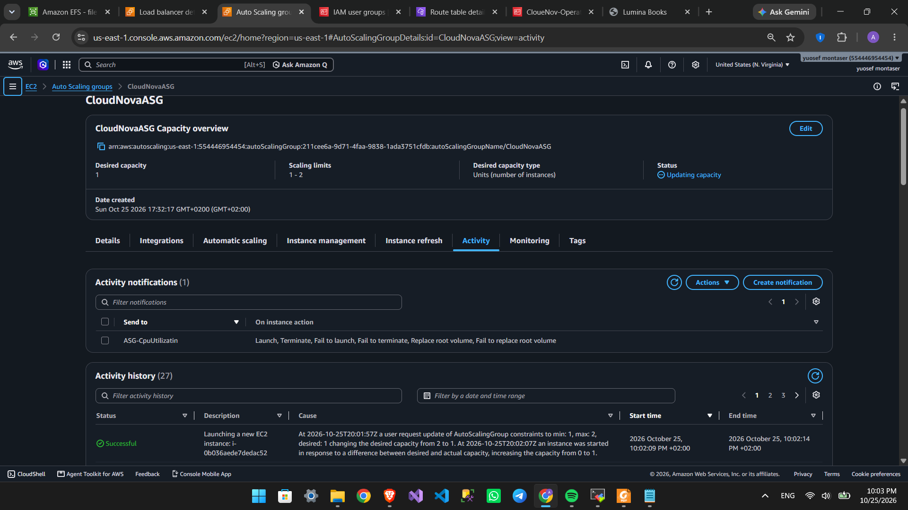
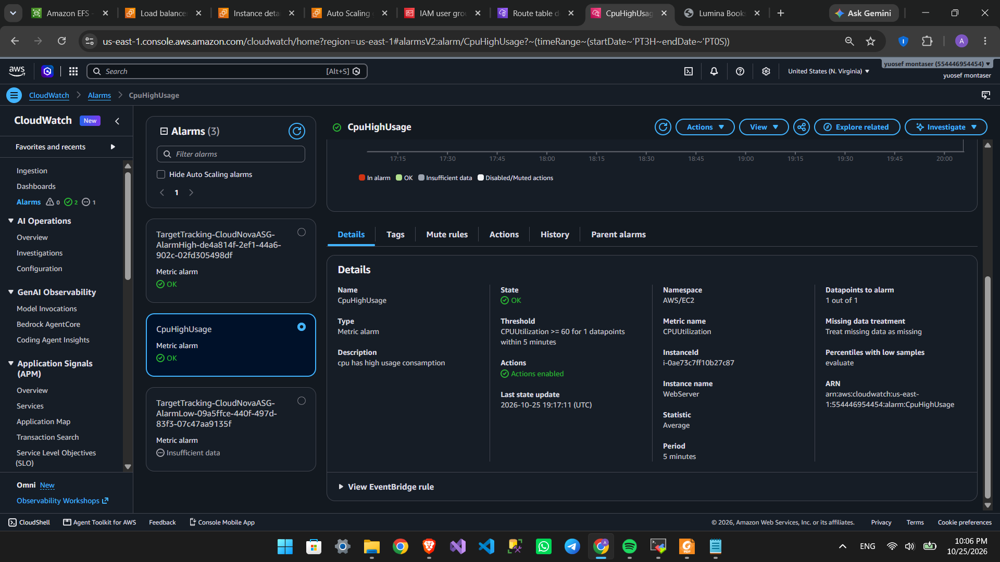
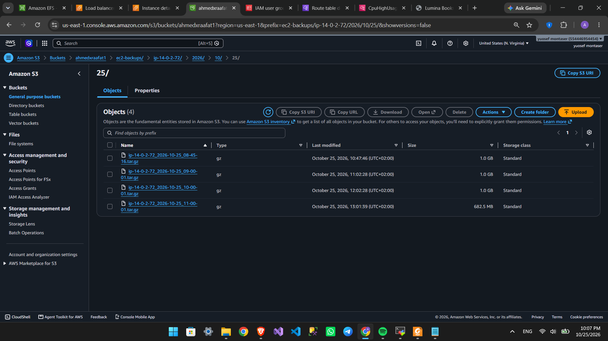
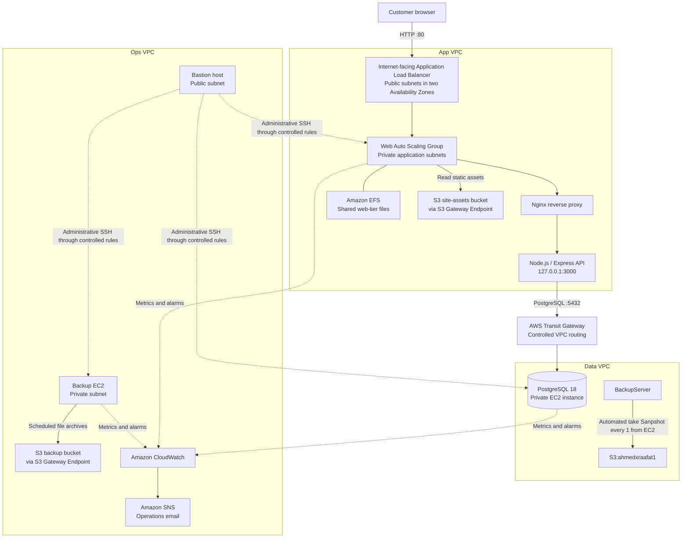

# Lumina — AWS-Hosted Bookstore Demo

[](#architecture)
[](#application)
[](#data-model)
[](#project-status)

**Lumina** is a demonstration bookstore application deployed on AWS. It combines a Node.js API and PostgreSQL database with a segmented, multi-VPC cloud environment designed to demonstrate private compute, controlled network connectivity, monitoring, automated instance recovery, and scheduled file backups.

> **Project type:** Portfolio / learning demonstration — not a production-ready commerce platform.  
> **Deployment model:** AWS resources were created manually in the AWS Console, supported by shell scripts. There is currently no one-click or Infrastructure-as-Code deployment.  
> **Author:** [@ahmadraafat22](https://github.com/ahmadraafat22)

---

## Table of contents

- [Project at a glance](#project-at-a-glance)
- [Screenshots](#screenshots)
- [Architecture](#architecture)
- [Application](#application)
- [Data model](#data-model)
- [AWS components](#aws-components)
- [Repository files](#repository-files)
- [Deployment overview](#deployment-overview)
- [Configuration](#configuration)
- [Operations and recovery](#operations-and-recovery)
- [Testing and validation](#testing-and-validation)
- [Security, limitations, and next steps](#security-limitations-and-next-steps)
- [Estimated cost](#estimated-cost)
- [Acknowledgements](#acknowledgements)
- [License](#license)

## Project at a glance

| Area | Summary |
|:---|:---|
| Application | Lumina bookstore demo storefront |
| Frontend | Responsive HTML/CSS/JavaScript storefront |
| API | Node.js 20, Express, PostgreSQL client (`pg`) |
| Database | PostgreSQL 18 on a private EC2 instance |
| Edge and web tier | Internet-facing Application Load Balancer (HTTP) and private EC2 web instances running Nginx and Node.js |
| Network | Separate App, Data, and Ops VPCs connected through an AWS Transit Gateway |
| Shared storage | Amazon EFS for web-tier shared files |
| Object storage | Amazon S3 for site assets and scheduled file archives; S3 Gateway VPC endpoints for App and Ops traffic |
| Resilience | Auto Scaling Group (ASG) with load-balancer health checks for web-instance recovery |
| Operations | CloudWatch alarms with notifications through Amazon SNS email subscriptions |
| Administration | Bastion host in the Ops VPC; application, database, and backup servers are private |
| Validation | The project owner reports successful application, alerting, ASG recovery, scheduled backup, and restore checks |

## Screenshots

Add screenshots to `docs/screenshots/` and replace each placeholder below with the corresponding Markdown image. **Redact public IPs, account numbers, ARNs, resource IDs, email addresses, credentials, and customer data before adding screenshots to a public repository.**

| Screenshot | Suggested file | Image |
|:---|:---|:---|
| Lumina home page / catalogue | `docs/screenshots/lumina-homepage.png` |  |
| Search, category filter, and cart | `docs/screenshots/lumina-shopping.png` |  |
| Checkout demo | `docs/screenshots/lumina-checkout.png` |  |
| ALB target health | `docs/screenshots/alb-target-health.png` |  |
| ASG recovery activity | `docs/screenshots/asg-activity.png` |  |
| Monitoring / notifications | `docs/screenshots/cloudwatch-sns.png` |  |
| Backup and restore evidence | `docs/screenshots/backup-restore.png` |  |
For example, after adding the homepage image, replace its placeholder with:

```markdown

```

## Architecture

The environment separates application, database, and operations responsibilities into three VPCs. The Transit Gateway provides routed connectivity between the VPCs. Public entry is through the Application Load Balancer; web, database, and backup servers are in private subnets. The bastion is the administrative entry point in the Ops VPC.



### Request and operations flows

1. A customer reaches the public ALB over HTTP. The ALB forwards requests to web instances in private application subnets.
2. Nginx serves the storefront and forwards `/api/` requests to the Node.js API on the same instance.
3. The API connects to PostgreSQL on the private DB server through the Transit Gateway.
4. Web instances access shared EFS storage and retrieve the static site asset from S3 as configured.
5. The private Backup EC2 runs a scheduled file-archive script and uploads archives to S3 through an S3 Gateway VPC Endpoint.
6. CloudWatch alarms notify the operations team through SNS. Administrators access private servers through the bastion, subject to security-group rules.

> The ALB is currently **HTTP-only**. HTTPS/TLS has not been configured. Do not treat this demo architecture as suitable for handling real customer or payment data.

## Application

Lumina is a bookstore storefront seeded with **12 books across six categories**: Fiction, Science, History, Business, Kids, and Poetry.

### User-facing features

- Browse the book catalogue.
- Search by title or author.
- Filter by category.
- Add items to a cart; cart state is stored in browser `localStorage`.
- View a free-shipping progress indicator with a `$35` threshold.
- Submit a checkout form that records an order in PostgreSQL.
- Use a responsive storefront layout.

### API endpoints

The API is served under `/api` on the same host as the frontend.

| Method | Path | Purpose | Success response |
|:---|:---|:---|:---|
| `GET` | `/api/health` | Health check used by the ALB | `{"ok":true}` |
| `GET` | `/api/books` | Return the catalogue | JSON array of books |
| `POST` | `/api/orders` | Validate and record an order | `{"orderId":123}` with HTTP `201` |

Example order request (use fictional data only):

```http
POST /api/orders
Content-Type: application/json

{
  "name": "Demo Customer",
  "email": "demo@example.invalid",
  "address": "123 Example Street",
  "items": [
    { "id": 1, "qty": 2 }
  ]
}
```

The API uses parameterized SQL for database operations, validates required order fields and item quantities, and obtains unit prices from the database rather than trusting client-provided prices.

## Data model

The database is named `lumina`. The schema has three main tables:

| Table | Purpose |
|:---|:---|
| `books` | Catalogue entries, prices, categories, ratings, and display metadata |
| `orders` | Customer-submitted demo order details and creation time |
| `order_items` | Books and quantities associated with an order, including the recorded unit price |

The supplied SQL file creates the tables and indexes and inserts seed data. `order_items.order_id` references `orders.id` with cascading deletion; `order_items.book_id` references `books.id`.

> **Privacy note:** The demo schema stores customer names, email addresses, and optional addresses. Use fictional/test data only. Do not load real customer information into a portfolio demonstration.

## AWS components

### Network and access

- **App VPC:** ALB, private web/Node instances, EFS, and the S3 site-assets route.
- **Data VPC:** private PostgreSQL EC2 instance with no public entry point.
- **Ops VPC:** bastion in a public subnet and private backup EC2 instance.
- **Transit Gateway:** routes permitted traffic between the VPCs.
- **Security groups:** control ALB-to-web, application-to-database, EFS mount, bastion administration, and backup access paths.
- **S3 Gateway VPC Endpoints:** allow the configured App and Ops route tables to reach S3 without sending that S3 traffic through a NAT Gateway.

Network CIDRs, IP addresses, AWS account numbers, ARNs, resource IDs, bucket names, and live endpoints are intentionally not published here. Replace any such values in scripts, screenshots, or other repository files with configuration variables/placeholders before making the repository public.

### Compute and storage

- **Web tier:** Ubuntu-based EC2 instances running Nginx and a Node.js API, managed by an ASG and registered with the ALB target group.
- **Database tier:** PostgreSQL 18 running on a private EC2 instance; this is a self-managed database server, not Amazon RDS.
- **Bastion:** restricted SSH jump host for administrative access to private instances.
- **Backup host:** private EC2 instance that creates scheduled compressed file archives and uploads them to S3.
- **EFS:** shared file system mounted by the web tier.
- **S3:** separate logical buckets for site assets and backup archives.

### Identity, monitoring, and recovery

- Separate EC2 IAM roles are used for App, Data, Ops, and Backup duties.
- CloudWatch alarms cover infrastructure/application availability signals such as high CPU, EC2 status checks, unhealthy ALB targets, ALB 5xx responses, and database storage monitoring.
- CloudWatch alarm actions publish to an SNS topic with operations email subscribers.
- The web ASG uses ELB health checks. When a target becomes unhealthy, the ASG can replace the instance from its launch configuration/template.

## Repository files

The supplied project files include:

| File / artifact | Description |
|:---|:---|
| `index.html` | Lumina storefront frontend |
| `server.js` | Node.js / Express API |
| `lumina-db-complete.sql` | Database schema, indexes, seed data, and queries |
| `setup.sh` | EC2 User Data/bootstrap script for the web server |
| `backup.sh` | Scheduled file archive and S3 upload script for Backup EC2 |
| `lumina-api.service` | systemd service definition for the API |
| Nginx configuration | Static file hosting and reverse proxy configuration |
| IAM policy JSON files | Policies for App, Data, Ops, and Backup roles |

The list above describes supplied artifacts; adjust the names/paths in this table to match the final repository layout. Do not commit `.env` files, private keys, database passwords, access keys, or unredacted AWS configuration.

## Deployment overview

This section documents the deployment shape, **not a one-command deployment**. The AWS infrastructure was built manually through the AWS Console. The scripts assist with instance setup and backup tasks; they do not provision the entire AWS environment.

### Prerequisites

- An AWS account and a selected deployment region.
- Familiarity with VPCs, subnets, route tables, security groups, IAM roles/instance profiles, EC2, ALB, ASG, Transit Gateway, EFS, S3, CloudWatch, and SNS.
- Node.js 20 and PostgreSQL client packages on the web instance (installed by the bootstrap process).
- A safely configured database credential supplied at runtime, not committed to source control.
- A verified list of project resource names/IDs kept in private deployment notes, not in the public README.

### High-level deployment sequence

1. **Plan the network.** Define non-overlapping VPC CIDRs and subnet/Availability Zone layout for App, Data, and Ops. Create the VPCs, Internet Gateways where needed, route tables, and security groups.
2. **Connect VPCs.** Create and attach the Transit Gateway, configure the route tables and VPC routes, and verify only intended inter-VPC paths are allowed.
3. **Create identity and storage.** Create the workload-specific IAM roles and instance profiles, EFS and mount targets, S3 buckets, and the App/Ops S3 Gateway VPC Endpoints.
4. **Create the database host.** Launch PostgreSQL on a private Data subnet, apply the schema and seed data from `lumina-db-complete.sql`, and restrict inbound database traffic to the application tier and approved operations path.
5. **Prepare the web tier.** Store the sanitized application assets in the site bucket, create the launch template using `setup.sh` as User Data, and place the ASG in private application subnets. Avoid hardcoding secrets into User Data.
6. **Configure public entry.** Create the ALB in public subnets across Availability Zones, configure its HTTP listener and target group, and set the target health-check path to `/api/health`.
7. **Prepare operations access and backups.** Deploy the bastion in its public subnet, restrict SSH to approved administrator sources, deploy the private Backup EC2, and configure `backup.sh` and its hourly cron schedule.
8. **Configure monitoring.** Create CloudWatch alarms and an SNS topic/subscription; confirm the email subscription and test notification delivery.
9. **Validate before demonstration.** Run the checks in [Testing and validation](#testing-and-validation), verify the ASG recovery path and backup restore, and capture sanitized screenshots.

> These steps are an overview based on the project notes. Exact console screens, deployment parameter values, and resource identifiers are environment-specific and are not included in the public README.

### Run the API locally (development outline)

The supplied API expects PostgreSQL and its Node.js dependencies. The exact package manifest and local database setup should be confirmed in the repository before using these illustrative commands:

```bash
# From the repository root, after reviewing package.json and the SQL schema
npm install

# Configure a local-only environment file; do not commit it.
cp .env.example .env
# Edit DATABASE_URL with your local test database connection.

node server.js
```

Then test the health endpoint:

```bash
curl -i http://127.0.0.1:3000/api/health
```

If `.env.example` is not present in the repository, create a sanitized template containing placeholders only. Never put a real credential in an example file.

## Configuration

The API reads its database connection string and runtime settings from environment variables. A safe template could look like this:

```dotenv
DATABASE_URL=postgresql://<DB_USER>:<DB_PASSWORD>@<PRIVATE_DB_HOST>:5432/lumina
PORT=3000
NODE_ENV=production
```

- Keep the real `.env` file out of Git (`.env`, `.env.*`, and credential files should be ignored; commit only a placeholder template).
- Set restrictive permissions on server-side environment files, for example `chmod 600 .env`.
- Prefer AWS Secrets Manager or Systems Manager Parameter Store for deployed secrets rather than embedding credentials in scripts, source, or User Data.
- The API binds to `127.0.0.1:3000`; Nginx forwards `/api/` requests to the local API process.

## Operations and recovery

### Service health

On a web instance, inspect the services using:

```bash
sudo systemctl status lumina-api
sudo systemctl status nginx
sudo nginx -t
```

The ALB health-check endpoint is `/api/health`. The ASG is configured to use load-balancer health checks so that an unhealthy web instance can be replaced.

### Scheduled file backups

The Backup EC2 runs the supplied `backup.sh` script hourly (at minute 0) through cron. The script archives the configured local source directory into a timestamped `.tar.gz` file and uploads it to the backup bucket via the S3 Gateway VPC Endpoint.

```cron
0 * * * * /home/ubuntu/backup.sh >> /home/ubuntu/backup.log 2>&1
```

Useful checks on the Backup EC2:

```bash
crontab -l
tail -20 /home/ubuntu/backup.log
aws s3 ls "s3://${BACKUP_BUCKET}/hourly/"
```

**Scope:** The current script backs up files from its configured source directory. It does **not** run `pg_dump` and should not be described as a PostgreSQL database backup. Confirm what files are present in the source directory and whether they include the data you intend to preserve.

### Restore a file archive

The project owner reports that a restore test has been completed. For a future restore, identify an archive key from the S3 listing and download that exact object; do not assume a special `LATEST` object exists.

```bash
export BACKUP_BUCKET="<your-backup-bucket>"
export BACKUP_KEY="hourly/<exact-backup-filename>.tar.gz"

aws s3 cp "s3://${BACKUP_BUCKET}/${BACKUP_KEY}" /tmp/lumina-backup.tar.gz
mkdir -p /tmp/lumina-restore
tar -xzf /tmp/lumina-backup.tar.gz -C /tmp/lumina-restore
find /tmp/lumina-restore -maxdepth 2 -type f -print
```

Restore into a separate location first, inspect the contents, and follow the relevant application recovery procedure before replacing any live files.

## Testing and validation

The project owner reports validation of the storefront/API, SNS notifications, web ASG recovery, scheduled backup upload, and archive restore. Repeat the checks in the target AWS environment before relying on them; capture sanitized evidence for the portfolio.

| Area | Example check | Expected result |
|:---|:---|:---|
| API health | `curl -i http://<ALB-DNS>/api/health` | HTTP success and `{"ok":true}` |
| Catalogue | Open the storefront or request `/api/books` | Seeded book records are returned |
| Order flow | Submit a demo order with fictional information | API returns an order ID; rows appear in `orders` and `order_items` |
| App-to-DB route | From a permitted app host, run a query using a protected `DATABASE_URL` | Database responds over the private network path |
| ALB target health | Inspect target-group health in AWS Console | Expected web targets report healthy |
| Self-healing | In a controlled test, terminate an ASG-managed web instance | ASG launches a replacement and the target becomes healthy |
| Notifications | Trigger a controlled alarm test | SNS delivers an email to the confirmed operations subscriber |
| Scheduled backup | Inspect cron and the backup log, then list the S3 prefix | Timestamped archive object appears |
| Restore | Download an archive to a temporary directory and inspect it | Archive extracts and expected files are present |

Do destructive/failure tests only in a controlled test environment and only when it is safe to interrupt the service.

## Security, limitations, and next steps

### Current limitations

- The ALB listener is HTTP-only; HTTPS/TLS is not configured.
- There is no user authentication or authorization.
- Checkout records a demo order only; no real payment processing is implemented.
- There is no order history/tracking or administrative panel.
- The cart is stored in browser `localStorage` and is not shared between devices.
- The scheduled backup script archives files only; it does not create a PostgreSQL backup.
- No S3 lifecycle retention policy is configured, so old archives may accumulate.
- The environment was assembled manually and is not currently reproducible from Infrastructure-as-Code.
- The cost figure below is a rough project estimate, not a live AWS bill or quote.

### Recommended hardening roadmap

1. Enable HTTPS on the ALB with an ACM certificate, redirect HTTP to HTTPS, and consider AWS WAF.
2. Move database secrets out of source and User Data into Secrets Manager or Parameter Store; rotate any credential that has been exposed.
3. Add a PostgreSQL-native backup strategy (for example, scheduled logical backups or a managed database service), define retention objectives, and test recovery regularly.
4. Configure and document S3 lifecycle retention, bucket public-access blocks, encryption requirements, and least-privilege bucket policies.
5. Review IAM policies and security-group rules against least privilege; remove permissions not required by the running workloads.
6. Consider AWS Systems Manager Session Manager instead of direct SSH through a bastion.
7. Add authentication, authorization, stronger application protections, and appropriate handling of personal data before any real-world use.
8. Capture application and operating-system logs centrally and define operational runbooks.
9. Add Infrastructure-as-Code (Terraform, CloudFormation, or CDK) and automated validation to make the environment repeatable.

### Public-repository checklist

Before publishing this repository, inspect **all tracked files and Git history**, not only this README:

- Remove and rotate any real password, access key, token, private key, or session credential.
- Remove AWS account IDs, live IP addresses, ARNs, resource IDs, hostnames, and sensitive operational details from public-facing files and screenshots.
- Add `.env`, `.pem`, private key, state, log, and local configuration files to `.gitignore` as appropriate.
- If a secret was committed previously, rotating it is essential; deleting it from the latest commit alone does not remove it from Git history.
- Confirm the VPC address plan is intentional and non-conflicting before publishing or rebuilding. Keep actual environment CIDRs out of this public README.
- Do not include real customer data, email addresses, or order records in screenshots or seed files.

## Estimated cost

The source project notes estimate the environment at approximately **$108 USD per month**. This is an author-provided rough estimate, not a current AWS quote. Actual charges vary with region, instance hours and sizes, NAT Gateway and data processing, ALB usage, EFS/S3 storage, Transit Gateway attachments/traffic, CloudWatch usage, and taxes. Validate costs with the AWS Pricing Calculator and billing alerts before leaving resources running.

| Resource group | Rough monthly estimate in project notes |
|:---|---:|
| Web and database EC2 | ~$30 |
| Bastion and backup EC2 | ~$16 |
| NAT Gateway and data | ~$32 |
| Application Load Balancer | ~$20 |
| EFS and S3 | ~$2.50 |
| Transit Gateway | ~$5 |
| CloudWatch and SNS | ~$3 |
| **Approximate total** | **~$108** |

The project notes estimate that using an S3 Gateway VPC Endpoint for backup traffic avoids NAT data-processing charges for that S3 path. Actual savings depend on traffic volume and current regional pricing; the endpoint does not eliminate the NAT Gateway's hourly charge.

## Acknowledgements

A big thank you to **NTI** for the learning opportunity, support, and guidance that helped make this project possible.

Special thanks to **Eng. Mohammed Hafez** for his valuable instruction, encouragement, and support throughout the project. I truly appreciate your contribution to my learning and to the completion of this work.

## License

No license has been specified. Unless a license is added to the repository, the default copyright applies and others do not automatically receive permission to reuse, modify, or distribute this project. Add a `LICENSE` file if you want to grant reuse rights.

---

**Author:** [@ahmadraafat22](https://github.com/ahmadraafat22)  
**Project:** Lumina — AWS Bookstore Portfolio Demo
